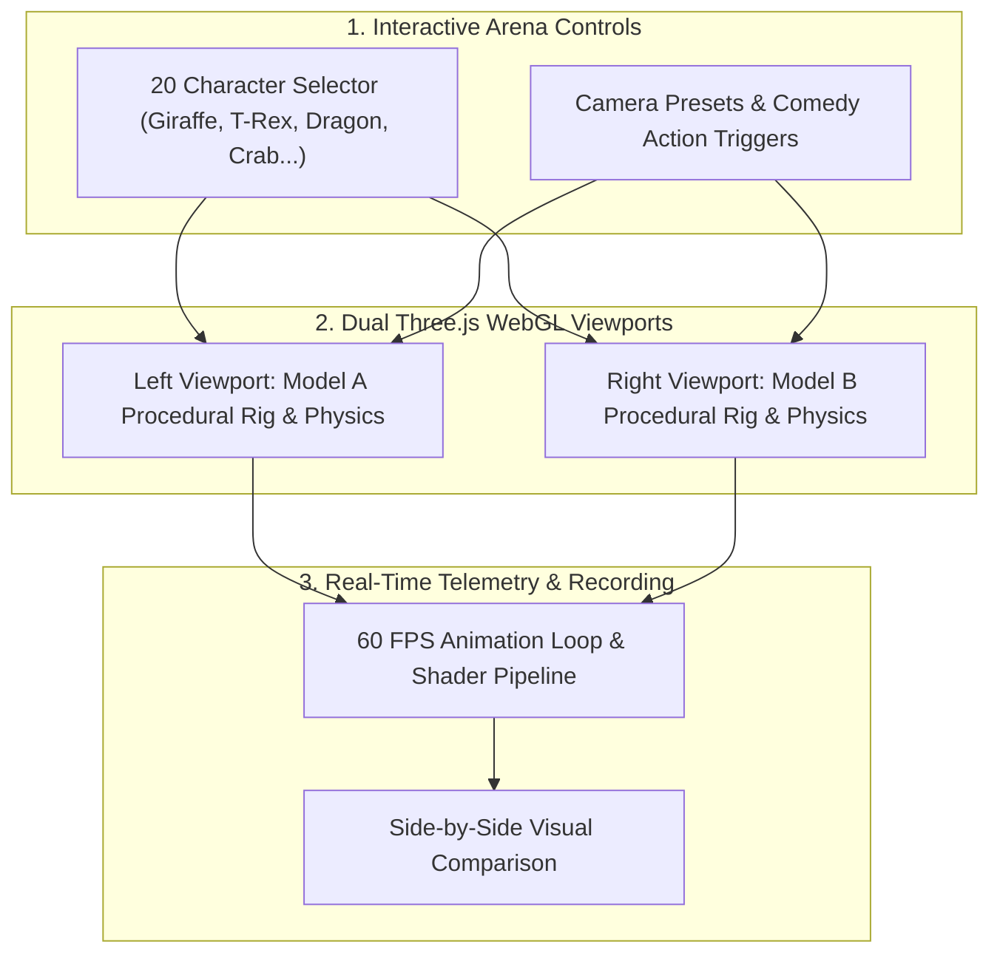

# 🦒🔥 3D LLM Comedy Benchmark Arena (20 Animals)

> **Author & Architect:** [Robina Mirbahar](https://github.com/RobinaMirbahar) (Google Developer Expert in Cloud & AI)  
> **Focus:** Interactive Side-by-Side Three.js WebGL Benchmark Studio for Frontier Models (20 Animated 3D Characters)

---

## 🎯 Why I Built 3D LLM Comedy Benchmark Arena (Engineering Purpose & Real-World Value)

### 1. 🎭 Visualizing Spatial & Procedural Code Generation
Static text leaderboards fail to capture how well frontier LLMs understand 3D geometry, kinematics, and procedural animation. I built this side-by-side 3D arena to test spatial reasoning visually at 60 FPS.

### 2. 🦒 20 Procedural 3D Animals & Comedy Physics
I implemented 20 articulated 3D characters (Giraffe, T-Rex, Cat, Crab, Dragon, Penguin, and more) with expressive procedural animations so anyone can compare model creativity and physical realism side by side.

### 3. 🎬 Zero-Dependency Browser Studio for Live Demos
I engineered the entire arena to run directly in the browser with custom camera presets, lighting controls, and recording-ready layouts for technical talks and benchmarks.

---

## 🏗️ System Architecture

---

An interactive split-screen **Three.js (WebGL) Viral Benchmark Studio** built with **Gemini 4 Argon API** for creating side-by-side 3D AI model comedy comparisons for **X (Twitter)** and **LinkedIn** (e.g., `Introducing Qwen 4 😀 — Opus 5.5 vs Qwen 4`, `Qwen 4 vs Gemini 4 Argon`, `Opus 5.5 vs Gemini 4 Carbon`, `Claude 4.6 Opus vs Qwen 4 Max`).

🔗 **Live Studio (GitHub Pages):** [https://robinamirbahar.github.io/llm-3d-comedy-arena/](https://robinamirbahar.github.io/llm-3d-comedy-arena/)

---

## ✨ Features

- **20 Funny 3D Procedural Animal Benchmarks (Dropdown Selection)**:
  1. 🦒 **Galloping Giraffe** (*Spaghetti Knees vs. Majestic National Geographic Gallop*)
  2. 🦖 **T-Rex Trying to Sprint** (*Tiny Arms Panic Attack vs. Jurassic Park Apex Predator*)
  3. 🐈 **Orange Cat 3 AM Zoomies** (*Vibrating 4-Polygon Loaf vs. Aerodynamic Parkour Champion*)
  4. 🦆 **Duck Late for Daily Standup** (*360° Head Spin vs. CEO Speed Waddle*)
  5. 🦀 **Crab Rave Party** (*Boiled Triangle Crisis vs. 120 BPM Mainstage Headliner*)
  6. 🐧 **Penguin Belly Toboggan** (*Tumbling Bowling Pin vs. Olympic Gold Medal Glider*)
  7. 🐉 **Cyber Mech Dragon** (*Flying Toaster Coughing Cubes vs. 18-Joint Procedural Shenron*)
  8. 🐙 **Octopus Coding at 400 WPM** (*Tangled Wet Spaghetti vs. 8 Inverse-Kinematic Tentacles*)
  9. 🐸 **Frog Doing Backflips** (*Uncontrolled GMod Ragdoll Glitch vs. Olympic Trampoline Champion*)
  10. 🦩 **Flamingo One-Leg Balance** (*Pink Lawnmower Falling Over vs. Flawless 1-Legged Zen Yoga*)
  11. 🐕 **Shiba Inu Doge Tippy-Taps** (*Sideways Toaster vs. Much Aerodynamics Very Tippy-Taps*)
  12. 🦈 **Shark Swimming in Air** (*Super Bowl Left-Shark Cardboard Derp vs. Hydrodynamic Apex*)
  13. 🦘 **Kangaroo Boxing Champion** (*Broken Pogo Stick Orbit Eject vs. Heavyweight Footwork & Bounce*)
  14. 🐘 **Elephant Helicopter Trunk** (*Vacuum Cleaner Tornado vs. Royal Safari Matriarch*)
  15. 🐢 **Turbo Rocket Turtle** (*Upside-Down Beyblade Spin vs. Twin-Turbo Nitro Drift Shell*)
  16. 🦍 **Gorilla Chest-Drum Hype** (*3-Polygon PS1 Tantrum vs. 400lb Silverback Alpha Aura*)
  17. 🐝 **Bumblebee Laws of Aviation** (*Error 404 Crash vs. 240Hz Precision Hover Pollinator*)
  18. 🦄 **Unicorn Rainbow Gallop** (*Cardboard Horse with Traffic Cone vs. Celestial Rainbow Pegasus*)
  19. 🐊 **Crocodile Death-Roll** (*Glitching Green Log Barrel-Roll vs. Jurassic Swamp Ambush*)
  20. 🦥 **Sloth on 10 Espressos** (*Caffeinated Potato at 9000 RPM vs. Supersonic Zen Jungle Acrobat*)
- **🔑 Bring Your Own Gemini API Key (BYOK — 100% Client-Side)**:
  - Anyone using the live studio can paste their own **Gemini API Key** (`AIza...`) into the toolbar to call **`gemini-4-argon`**, **`gemini-3.8-flash`**, **`gemini-3.5-flash-lite`**, or **`gemma-4-31b-it`** directly from their browser via the official `@google/genai` Interactions API (`client.interactions.create`).
  - Your API key is stored **only in your own browser's `localStorage`** and is never shared with any external backend. Also includes a **Demo Mode** that works out-of-the-box without an API key.
- **Clean Dropdown Selectors for Models, Matchups & Hooks**:
  - **Quick Matchup Preset Dropdown**: `Introducing Qwen 4 😀 (Opus 5.5 vs Qwen 4)`, `Claude 4.6 Opus vs Qwen 4`, `GPT-5.5 Turbo vs Qwen 4 Max`, `Opus 5.5 vs Gemini 4 Argon`, `Qwen 4 vs Gemini 4 Argon`, `Opus 5.5 vs Gemini 4 Carbon`, etc.
  - **Left & Right Model Dropdowns**: `Qwen 4 😀`, `Qwen 4 Max`, `Qwen 4 Coder`, `Qwen 4 235B`, `Gemini 4 Argon ⚡`, `Gemini 4 Carbon`, `Opus 5.5`, `Claude 4.6 Opus`, `GPT-5.5 Turbo`, `DeepSeek R2`, `Gemma 4 31B-IT`, `Llama 4 405B`, `Grok 4 Unhinged`.
  - **✨ Gemini 4 Argon API Live Roast Button**: Generates fresh AI benchmark roasts and ready-to-post X / LinkedIn captions.
- **⏺ 1-Click 60 FPS `.webm` Video Export**:
  - Records an 8-second side-by-side 1280×800 video with headers, roast badges, divider line, and `@RobinaMirbahar • Gemini 4 Argon API` watermark.

<!-- AUTHOR_SIGNATURE_START -->
---

## 👩‍💻 About the Author

**Robina Mirbahar — Google Cloud & AI Architect**  
*Google Developer Expert (GDE) in Cloud & AI • Published Author • Multi-Agent Systems & Serverless GPU Builder*

<!-- AUTHOR_SIGNATURE_END -->
